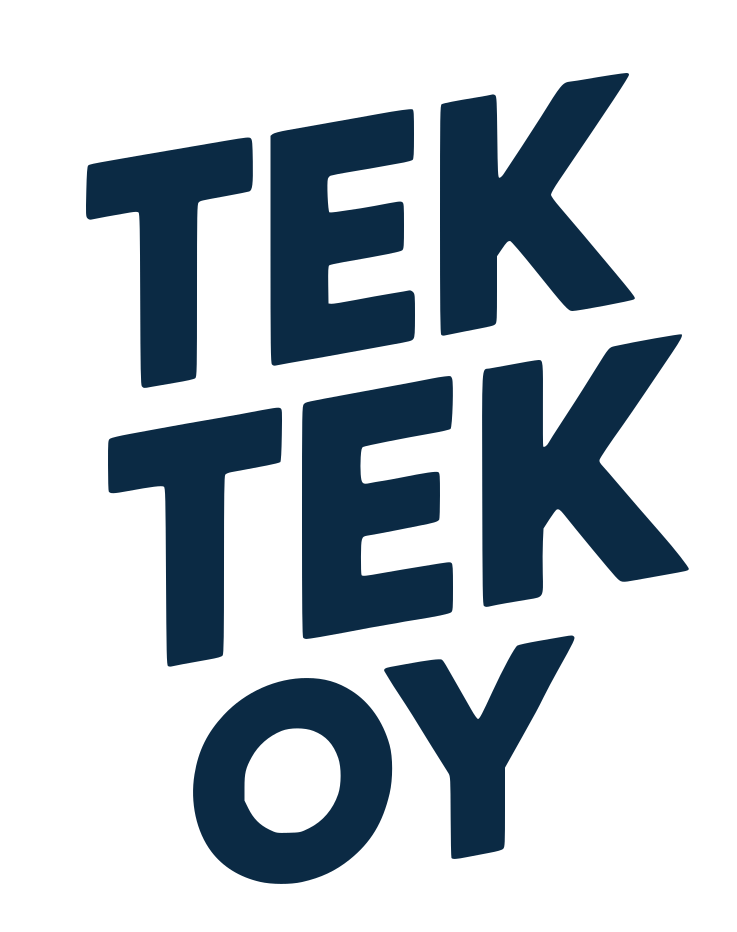

# tektek brand

The brand for tek tek oy and everything under tektek.fi: logo, colours, fonts, icons.

**Edit `brand.json`, then run `python3 build.py`.** The logo, tokens, icons and preview are all generated from it, so nothing else needs editing.

## Files

| File | What it is | Edit it? |
|---|---|---|
| `brand.json` | Colours, roles, fonts, logo source, tagline | Yes, this is the source |
| `build.py` | Builds everything from `brand.json` | Only to change how things are drawn |
| `trace_logo.py` | Traces the logo from the sketch PNG into `logo/src/` | Only to re-trace a new sketch |
| `logo/src/logo-traced.svg` | The logo traced from the sketch (source) | Only by re-tracing, see below |
| `logo/tektek-logo.svg` | Main logo, ink colour on transparent | No, generated |
| `logo/tektek-logo-reverse.svg` | Logo in background colour on the ink colour | No, generated |
| `logo/tektek-tagline.svg` | GOOD COFFEE / BETTER CODE | No, generated |
| `icons/src/*.svg` | Icon designs, drawn with `currentColor` | Yes, to change an icon's shape |
| `icons/*.svg` | Icons in the ink colour | No, generated |
| `tokens.css` | Colours and fonts as CSS variables | No, generated |
| `preview.html` | One page showing the whole brand | No, generated. Open it in a browser to check |
| `fonts/` | Archivo Black (open licence, see `OFL.txt`) | Only to change the typeface |

## Changing things

- **A colour:** change its hex in `colors`. Everything that uses it updates.
- **Which colour is used for what:** change `roles`, for example `"ink": "navy"`. Websites should use the role names, not the hex codes.
- **The logo shape:** the logo is traced from the sketch, so its shape is fixed in `logo/src/logo-traced.svg`. To change it, draw a new version, save it as a PNG, and point `trace_logo.py` at it (`SKETCH` and `CROP`), then run `python3 trace_logo.py` and `python3 build.py`.
- **The tagline:** change `tagline.lines`.
- **A new icon:** add an SVG to `icons/src/` using `currentColor` for its fill or stroke, then run the build.

Run `python3 build.py` after every change. It needs `fonttools` (`pip3 install fonttools`).

## Using the brand in a website

```html
<link rel="stylesheet" href="https://.../tokens.css">
```

```css
h1 { font-family: var(--tektek-font-display); color: var(--tektek-ink); }
.button { background: var(--tektek-accent); color: var(--tektek-background); }
```

```html

```

Use `tokens.css` and `var(--tektek-...)` names instead of hard-coded colours, so a brand change reaches every project.

## Notes

- The sketch the colours came from was a photo. The hex codes on it were used as written, except that coral's code was read from a small label, so check it.
- The logo is a traced vector, so it looks the same on any computer. The tagline's letters are converted to outlines from Archivo Black.
